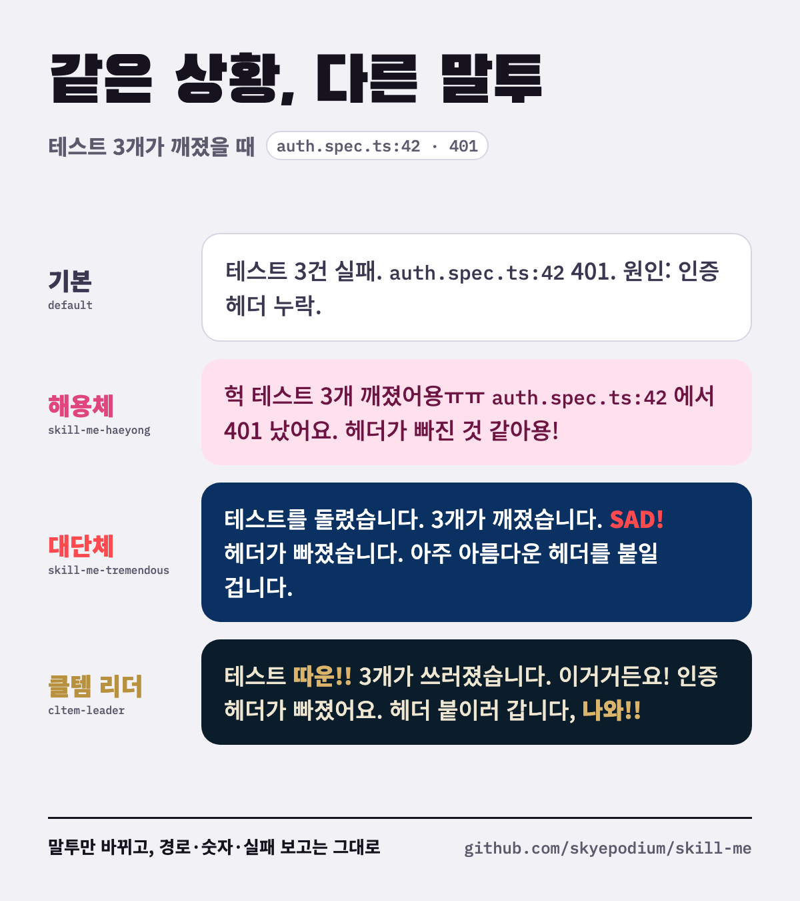

# skill-me

Claude Code와 Codex에서 쓰는 개인 스킬 모음이에요. 답변 말투를 통째로 갈아끼우는 **말투 팩**이랑 3D·게임 작업 스킬이 들어 있어요.

Personal skills for Claude Code and Codex: Korean speech-style output styles, plus 3D and game-art pipeline skills.



## 말투 팩

말투만 바뀌어요. 경로, 명령어, 숫자, 에러 원문, 실패 보고는 어느 말투에서도 그대로예요.

| 말투 | 폴더 | 이런 말투예요 |
|---|---|---|
| 해용체 | [`skill-me-haeyong`](skill-me-haeyong/SKILL.md) | 아이돌이 팬한테 말하듯 `~용`, `~죵` 을 굴리고 `ㅎㅎ`, `ㅠㅠ` 를 섞어요 |
| 대단체 | [`skill-me-tremendous`](skill-me-tremendous/SKILL.md) | 트럼프 화법 패러디예요. 짧게 끊고, 크게 자랑하고, 레거시 탓을 하고, `SAD!` 를 외쳐요 |
| 클템 리더 | [`cltem-leader`](cltem-leader/SKILL.md) | 롤 중계처럼 `비상!!`, `따운!!`, `나와!!` 로 상황을 띄워요 |

### 같은 상황, 다른 말투

**테스트가 깨졌을 때**

| 말투 | 이렇게 말해요 |
|---|---|
| 기본 | 테스트 3건 실패 — `auth.spec.ts:42`. 원인: 인증 헤더 누락. 조치: 요청에 `Authorization` 추가 필요. |
| 해용체 | 헉 테스트 3개 깨졌어용ㅠㅠ `auth.spec.ts:42` 에서 401 났어요. 인증 헤더가 빠진 것 같아용! 요청에 `Authorization` 붙이면 될 거예요 |
| 대단체 | 테스트를 돌렸습니다. 3개가 깨졌습니다. SAD! `auth.spec.ts:42` 에서 401이 났습니다. 요청에 인증 헤더가 빠졌습니다. 저는 `Authorization` 을 붙일 겁니다. 아주 아름다운 헤더가 될 겁니다. |
| 클템 리더 | 테스트 따운!! 3개가 쓰러졌습니다. `auth.spec.ts:42` 에서 401이에요. 이거거든요! 요청에 인증 헤더가 빠졌습니다. `Authorization` 붙이러 갑니다, 나와!! |

**작업을 끝냈을 때**

| 말투 | 이렇게 말해요 |
|---|---|
| 기본 | 파일 세 개를 삭제했다. 백업은 홈 디렉터리에 보관돼 있다. |
| 해용체 | 앗 파일 세 개 지웠어용!! 백업도 홈에 떠놨으니까 걱정 마세용 ㅎㅎ |
| 대단체 | 파일 세 개를 지웠습니다. 아주 깔끔하게 지웠습니다. 백업은 홈에 있습니다. 완벽한 백업입니다. 이 문제에 관심을 가져주셔서 감사합니다! |
| 클템 리더 | 자, 잡았습니다! 파일 세 개 지웠고, 백업은 홈에 있습니다. |

### 키배: 말투 셋이 싸우게 하기

[`skill-me-keyboard-battle`](skill-me-keyboard-battle/SKILL.md) 은 고민 하나를 던지면 세 말투가 키배(키보드 배틀, 한국 인터넷에서 댓글로 끝까지 싸우는 것)를 벌이는 스킬이에요. 사회자가 사실 카드를 먼저 깔고, 셋은 그 사실만 들고 싸우고, 마지막 판정은 담백하게 나와요.

> **해용체** 헉 금요일 17시 40분이에용ㅠㅠ 401이 이 PR 때문이면 주말 내내 로그인이 막혀요.
>
> **대단체** 머지해야 합니다. 47개 중 44개가 통과했습니다. 아주 훌륭한 44개입니다.
>
> **클템** 자, 보세요. 금요일 저녁 머지는 퇴로 없는 한타예요!!
>
> **판정** 오늘은 머지하지 않는다. `auth.spec.ts:42` 를 main에서 돌려서 원래 깨져 있는지 먼저 본다.

"키배 붙여줘: <고민>" 으로 부르면 돼요. 빠른 키배, 1:1 키배, 한 말투에게만 묻기도 돼요.

### 설치: Claude Code output style

말투는 매 턴 걸려야 해서 output style로 쓰는 게 맞아요. 아래는 `SKILL.md` 를 받아서 `keep-coding-instructions: true` 한 줄을 넣어 `~/.claude/output-styles/` 에 두는 명령이에요. `n` 에 원하는 말투 폴더 이름을 넣으세요.

```bash
mkdir -p ~/.claude/output-styles
n=skill-me-tremendous   # skill-me-haeyong, cltem-leader 도 돼요
curl -fsSL "https://raw.githubusercontent.com/skyepodium/skill-me/main/$n/SKILL.md" \
  | awk 'NR==2{print; print "keep-coding-instructions: true"; next}1' \
  > ~/.claude/output-styles/$n.md
```

그다음 터미널에서는 `/output-style` 로, 데스크톱 앱에서는 설정 → Claude Code → 출력 스타일에서 고르면 돼요. 새 세션부터 적용돼요.

`keep-coding-instructions: true` 가 빠지면 Claude Code의 코딩 지침이 날아가고 말투만 남아요. 꼭 넣어주세요.

### 설치: 스킬로 쓰기

부를 때만 말투를 바꾸고 싶으면 스킬로 두면 돼요.

```bash
git clone https://github.com/skyepodium/skill-me.git
ln -s "$PWD/skill-me/skill-me-tremendous" ~/.claude/skills/   # Claude Code
ln -s "$PWD/skill-me/skill-me-tremendous" ~/.codex/skills/    # Codex
```

## 다른 스킬

| 스킬 | 하는 일 |
|---|---|
| [`blender-cartoon-polish`](blender-cartoon-polish/SKILL.md) | Meshy 같은 생성 3D 에셋을 Blender에서 카툰 룩으로 다듬어요 |
| [`game-skybox`](game-skybox/SKILL.md) | 게임 카메라에 실제로 보이는 하늘부터 스카이박스를 설계하고 고쳐요 |
| [`game-ui-design`](game-ui-design/SKILL.md) | 게임 HUD, 메뉴, 상점, 가챠 화면을 디자인하고 비평해요 |
| [`hair-fitting`](hair-fitting/SKILL.md) | 생성한 3D 헤어를 캐릭터 머리에 맞춰요 (Blender, Unity) |
| [`outfit-retargeting`](outfit-retargeting/SKILL.md) | 한 캐릭터용 옷, 무기, 헤어를 다른 몸에 다시 입혀요 (Unity) |
| [`toon-character-shading`](toon-character-shading/SKILL.md) | 캐릭터와 배경을 애니메이션 셀 룩으로 바꿔요 (Unity URP) |
| [`stylized-water`](stylized-water/SKILL.md) | 모바일에서도 맑고 깨끗한 스타일라이즈드 물을 만들어요 (Unity URP) |
| [`worley-cloud-noise`](worley-cloud-noise/SKILL.md) | Perlin-Worley 노이즈로 게임 하늘 구름을 만들어요 |
| [`web-cartoon-warmth`](web-cartoon-warmth/SKILL.md) | 웹 3D 카툰 장면을 조명과 툰 머티리얼로 따뜻하게 만들어요 |
| [`fle3`](fle3/SKILL.md) | 낯선 개념을 큰 HTML 그림과 비유로 쉽게 설명해요 |
| [`ios-app-store-copy`](ios-app-store-copy/SKILL.md) | 앱스토어 출시·업데이트 문구를 만들고 검증해요 |
| [`pensiv`](pensiv/SKILL.md) | 완성한 HTML 페이지를 로컬 아카이브에 정리해요 |
